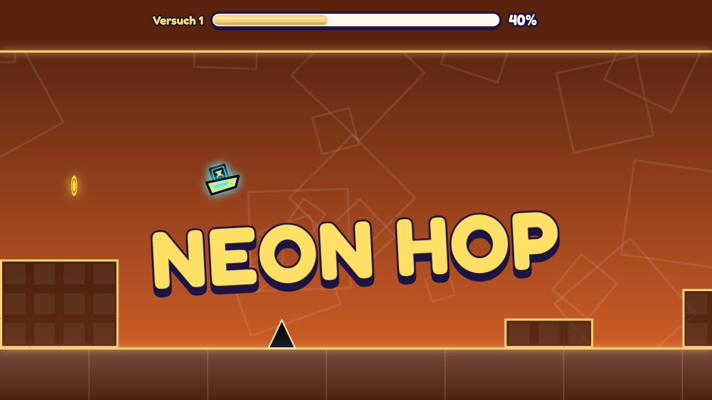

# Neon Hop

Ein rhythmischer Hüpf-Runner für **Toki** (unsere eigene Browser-Spieleseite).
Der Würfel läuft automatisch – du springst im richtigen Moment, fliegst mit der
Rakete durch Tunnel und drehst die Schwerkraft um.



## Features

- 15 Level in vier Stufen:
  - Leicht: *Erster Sprung*, *Sonnenpfad*, *Kristallhöhle*, *Erster Flug*
  - Mittel: *Neon-Himmel*, *Tiefsee*, *Vulkan*, *Polarlicht*, *Turbo-Tunnel*
  - Schwer: *Umkehr*, *Schattenwerk*, *Sternenstaub*, *Glitch*
  - Extrem: *Nachtschicht*, *Neon-Kern*
- Würfel- und Raketen-Modus, Sprungfelder, gelbe/blaue Ringe, Schwerkraft-Portale
- 3 Münzen pro Level, Bestwerte in % (Normal und Übung)
- Übungsmodus mit automatischen und manuellen Checkpoints
- Selbst erzeugte Musik und Sounds (Web Audio, keine Audiodateien)
- 6 Farben für den Würfel
- Läuft auf PC (Tastatur/Maus) und Handy/Tablet (Touch, Querformat)
- Fortschritt wird lokal im Browser gespeichert (`localStorage`)
- Keine Abhängigkeiten, kein Build-Schritt – reines HTML/CSS/JavaScript

## Steuerung

| Aktion | Taste |
| --- | --- |
| Springen / Rakete hoch | Leertaste, ↑, W, Klick oder Tippen |
| Pause | Esc oder P |
| Neu starten | R |
| Checkpoint setzen / löschen (Übung) | Z / X |

Gedrückt halten = automatisch wieder springen, sobald der Würfel landet.

## Lokal starten

Einfach `index.html` im Browser öffnen, oder einen kleinen Server starten:

```bash
python3 -m http.server 8000
```

Dann <http://localhost:8000> öffnen.

## Auf Toki hochladen

Das Spiel ist ein statischer Ordner. Hochzuladen sind:

```
index.html
js/
assets/
```

`tools/` und die `.md`-Dateien werden im Spiel nicht gebraucht. Als
Vorschaubild kann `assets/thumbnail.png` (1280×720) verwendet werden, als
Icon `assets/icon.svg`.

Das Spiel funktioniert auch in einem `<iframe>`:

```html
<iframe src="/games/neon-hop/index.html" allow="autoplay; fullscreen" style="border:0;width:100%;aspect-ratio:16/9"></iframe>
```

## Level bearbeiten

Die Level stehen in [`js/levels.js`](js/levels.js), entweder als Text-Karten
(`#` Block, `^` Stachel, `o` Ring, `S` Raketen-Portal …, die Legende steht oben
in der Datei) oder zusammengesetzt aus Bausteinen wie `pillars`, `stairs`,
`padTower`, `orbChain`, `ship`, `grav` und `blue`. Die Reihenfolge im Menü
legt die Liste `ORDER` am Ende der Datei fest. Nach jeder Änderung prüfen, ob das Level noch schaffbar ist:

```bash
node tools/verify-levels.js
```

Das Skript probiert per Breitensuche alle Eingabefolgen durch (mit höchstens
30 Eingaben pro Sekunde, also menschlich machbar) und zeigt bei einem Fehler die
Stelle, an der kein Weg mehr weiterführt. Es prüft auch, ob alle Münzen
erreichbar sind.

## Aufbau

| Datei | Inhalt |
| --- | --- |
| `js/engine.js` | Physik und Kollisionen (läuft auch in Node) |
| `js/levels.js` | Level-Daten |
| `js/audio.js` | Musik-Sequenzer und Soundeffekte |
| `js/game.js` | Grafik, Eingabe, Menüs, Speicherstand |
| `tools/verify-levels.js` | Prüft, ob alle Level schaffbar sind |

## Hinweis

Neon Hop ist ein eigenständiges Spiel im Genre der Rhythmus-Runner. Name,
Grafik, Musik und Level sind selbst gemacht; es verwendet keine Inhalte aus
anderen Spielen.
